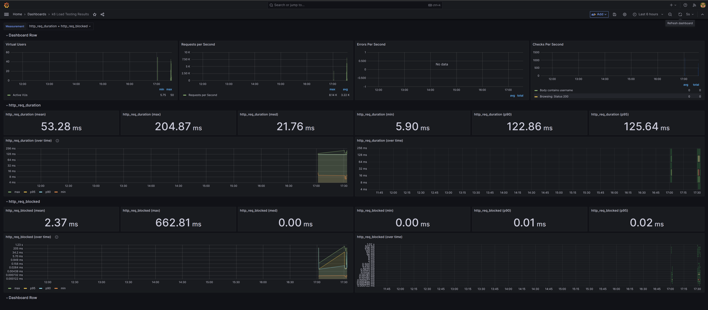

# K6 Load Testing Project with InfluxDB and Grafana


A comprehensive load testing solution using k6 for testing, InfluxDB for metrics storage, and Grafana for visualization.

## How It Works

### Data Flow Architecture

1. **k6 Execution**:
    - k6 runs the test scripts and collects metrics in real-time
    - Metrics are streamed directly to InfluxDB using the `--out` parameter

2. **InfluxDB Storage**:
    - Acts as the time-series database storing all test metrics
    - Pre-configured with:
        - Database: `k6`
        - Retention policies for data management
        - Authentication: k6/k6 (user/pass)

3. **Grafana Visualization**:
    - Automatically configured with:
        - Pre-defined DataSource pointing to InfluxDB
        - Auto-provisioned dashboards
        - Pre-configured queries and visualizations

### Automatic Setup Features

- **Zero-Configuration Dashboard**:
    - The dashboard is automatically loaded from the JSON definition in `grafana/provisioning/dashboards/`
    - No manual import or configuration needed

- **Pre-configured DataSource**:
    - Defined in `grafana/provisioning/datasources/`
    - Automatically connects to InfluxDB on startup
    - Includes proper authentication and query settings

- **Persistent Configuration**:
    - All configurations are stored in version control
    - Rebuilds are consistent across different environments
    - No manual steps required after initial setup


## Table of Contents
- [Prerequisites](#prerequisites)
- [Project Structure](#project-structure)
- [Getting Started](#getting-started)
- [Available Test Scripts](#available-test-scripts)
- [Viewing Test Results](#viewing-test-results)
- [Test Configuration](#test-configuration)
- [Dashboard Features](#dashboard-features)
- [Component Details](#component-details)
- [Resources](#resources)

## Prerequisites

- [Docker](https://docs.docker.com/get-docker/) and [Docker Compose](https://docs.docker.com/compose/install/)
- [k6](https://k6.io/docs/get-started/installation/)

## Project Structure

```
.
├── docker-compose.yml           # Docker Compose configuration
├── tests/
│   ├── basic_test.js           # Basic test scenario
│   ├── stress_test.js          # Stress testing scenario
│   ├── data_param.js           # Test with parameterized data
│   ├── db_isolation.js         # Database performance test
│   ├── combined_load.js        # Combined test scenarios
│   ├── data/
│   │   └── users.json          # Test user credentials
│   └── db/
│       └── init-db.sql         # Database initialization script
├── influxdb/                   # InfluxDB configuration
└── grafana/
    └── provisioning/           #Grafana provisioning files
        ├── dashboards/
        └── datasources/
```

## Getting Started

1. Start the services:
   ```
   docker-compose up -d
   ```

2. Run your desired test (see [Available Test Scripts](#available-test-scripts))

3. View results in Grafana (see [Viewing Test Results](#viewing-test-results))

## Available Test Scripts

### 1. Basic Load Test
```
docker compose run --rm k6_runner run /app/tests/basic_test.js --out influxdb=http://influxdb:8086/k6
```

### 2. Stress Test
```
docker compose run --rm k6_runner run /app/tests/stress_test.js --out influxdb=http://influxdb:8086/k6
```

### 3. Data Parameterization Test
**Prerequisites:** `tests/data/users.json` with user credentials
```
docker compose run --rm k6_runner run /app/tests/data_param.js --out influxdb=http://influxdb:8086/k6
```

### 4. Database Isolation Test
**Prerequisites:** `tests/db/init-db.sql` for database initialization
```
docker compose run --rm k6_runner run /app/tests/db_isolation.js --out influxdb=http://influxdb:8086/k6
```

### 5. Combined Load Test
```
docker compose run --rm k6_runner run /app/tests/combined_load.js --out influxdb=http://influxdb:8086/k6
```

## Viewing Test Results

1. Open http://localhost:3000 in your browser
2. Login with:
   - Username: `admin`
   - Password: `admin`
3. Navigate to Dashboards → Browse
4. Select the "k6 Load Test Dashboard"


## Dashboard Features

The k6 dashboard includes:
- Response time metrics (p95, p99, max)
- Request rate and error rate
- Virtual users count
- Data transfer rates
- HTTP status code distribution

## Component Details

### k6 Test Scripts
Location: `./tests/*.js`
- Define test scenarios and virtual users
- Configure HTTP requests and validations
- Set success/failure thresholds
- Collect metrics like `http_req_duration`, `http_reqs`, `vus`, and `checks`

### InfluxDB
- Time-series database for metrics
- Port: 8086
- Database: k6
- Credentials: k6/k6

### Grafana
- Web-based visualization platform
- Pre-configured dashboards in `grafana/provisioning/dashboards/`
- Data source configuration in `grafana/provisioning/datasources/`
- Default access:
    - URL: http://localhost:3000
    - Username: admin
    - Password: admin

## Dashboard Preview



## Resources

- [k6 Documentation](https://k6.io/docs/)
- [InfluxDB Documentation](https://docs.influxdata.com/influxdb/)
- [Grafana Documentation](https://grafana.com/docs/)
- [k6 + InfluxDB +Grafana Guide](https://k6.io/docs/results-output/real-time/influxdb-+-grafana/)